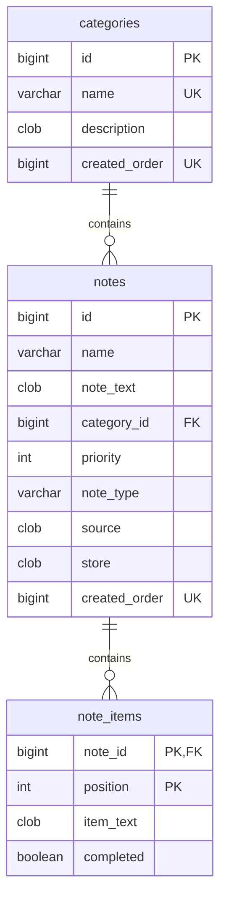

# Personal-notate — ЛР №10

Maven і робота з реляційною БД через JDBC. Продовження ЛР №7–9: нотатки, категорії та пункти списків зберігаються у файловій H2 й доступні після перезапуску.

## Запуск

Потрібні **JDK 25** та **Apache Maven 3.9.x**. Maven встановлюється з https://maven.apache.org/download.cgi; його папка bin додається до Path Windows. JAVA_HOME має вказувати на папку JDK. Після налаштування перевідкрийте термінал.

Відкрийте CMD або PowerShell у папці проєкту, де лежить pom.xml:

```powershell
java --version
javac --version
mvn --version
chcp 65001
mvn compile
mvn exec:java
```

У виводі Maven також має бути Java 25. Під час першої збірки потрібен інтернет для залежностей. IDE та окремий сервер БД не потрібні.

При першому запуску автоматично створюються таблиці та файл `data/personal-notate.mv.db`. Запускайте програму з кореня проєкту, оскільки шлях до БД відносний. Для перевірки збереження створіть нотатку, вийдіть через 0, знову виконайте `mvn exec:java` та відкрийте її за ID. Не запускайте дві копії програми одночасно з тією самою файловою БД.

## Користування

Введіть номер дії та натисніть Enter.

| Пункт | Дія |
| --- | --- |
| 1 | Додати текстову нотатку, список справ або покупок |
| 2 | Показати назви та постійні ID |
| 3 | Знайти та порахувати за пріоритетом |
| 4 | Показати копію за пріоритетом |
| 5 | Знайти за повним збігом вмісту |
| 6 | Відкрити нотатку за ID |
| 7–8 | Змінити або порівняти формати показу |
| 9 | Кількість у БД та історія додавань за сеанс |
| 10–11 | Демонстрація наслідування та підказка для типу |
| 12–13 | Оновити або видалити за ID |
| 14–15 | SQL-сортування за назвою / назвою та пріоритетом |
| 16 | Попередня демонстрація CRUD на колекціях |
| 17 | Керувати каталогом категорій |
| 18 | Перенести нотатки в іншу категорію й видалити стару |
| 19 | Переглянути назви сторінками |
| 20 | Демонстрація JDBC та rollback в окремій тимчасовій БД |
| 0 | Вийти |

Назва непорожня, до 255 символів; пріоритет 1–10, де 1 — найвищий. Enter завершує введення поля. Пункти списків не можуть бути порожніми. Зберігаються також джерело текстової нотатки, магазин і стани виконання пунктів.

При оновленні вводяться всі нові поля; ID залишається тим самим, кількість не збільшується. Можна змінити тип нотатки: старі пункти тоді прибираються в тій самій транзакції. Невдала операція не залишає часткових змін.

Категорія тепер пов’язана з нотаткою: введена назва використовує існуючий запис або створює новий. Порожнє поле означає «Без категорії». Перейменування категорії видно в її нотатках при наступному читанні. Видалення зайнятої категорії заборонене; спочатку використайте пункт 18 для перенесення записів.

Сортування не змінює ID або порядок додавання. Пропуски ID допустимі: послідовність не повертає виданий номер після rollback. Observer рахує додавання лише за поточний сеанс; це не історія всіх запусків. Демонстрації 10, 16 та 20 не змінюють ваш блокнот.

## Налаштування та Maven

`pom.xml`: GAV `ua.twiniii:personal-notate:10.0.0`, release 25, UTF-8. H2 — `com.h2database:h2:2.3.232`. Його scope compile, оскільки код використовує JdbcDataSource. JUnit має scope test. Compiler Plugin компілює, Surefire виконує тести, Exec Plugin запускає Main.

`src/main/resources/application.properties`:

```properties
db.url=jdbc:h2:file:./data/personal-notate;COLLATION=UKRAINIAN
db.user=sa
db.password=
```

Це початкові налаштування локальної навчальної БД. Для власних параметрів можна створити `config/application-local.properties` з такими самими ключами. Він ігнорується Git. Змінні середовища NOTATE_DB_URL, NOTATE_DB_USER, NOTATE_DB_PASSWORD мають вищий пріоритет. Реальні паролі не додаються в репозиторій. Зміна пароля у файлі сама по собі не змінює пароль уже створеної БД.

URL і пароль не зашиті в DBConnection. `target` містить результати Maven, `data` — локальні дані; обидві папки ігноруються Git. `mvn clean` видаляє target, але не data.

## Файли

| Шлях | Призначення |
| --- | --- |
| `src/main/java/Main.java` | Меню та створення залежностей |
| `src/main/java/models` | BaseEntity, Category та ієрархія Note з попередніх робіт |
| `src/main/java/interfaces` | Незмінені CRUDService і NoteService та попередні контракти |
| `src/main/java/database/DBConnection.java` | Singleton із DataSource |
| `src/main/java/database/SchemaInitializer.java` | Автоматичне виконання init.sql |
| `src/main/java/database/JdbcIdSequence.java` | Постійна послідовність ID |
| `src/main/java/services/jdbc/AbstractJdbcCrudService.java` | Спільний каркас JDBC-операцій |
| `src/main/java/services/jdbc/JdbcNoteService.java` | SQL нотаток і відновлення всіх підтипів |
| `src/main/java/services/jdbc/JdbcCategoryService.java` | SQL категорій та пакетна вставка |
| `src/main/java/services/jdbc/CategoryTransferService.java` | Транзакція перенесення нотаток |
| `src/main/java/exceptions/DataAccessException.java` | Помилка сховища зі збереженою причиною |
| `src/main/java/demo/JdbcDemo.java` | Окрема перевірка вимог JDBC |
| `src/main/java/demo/BatchBenchmark.java` | Вимірювання пакетної вставки |
| `src/main/resources/init.sql` | Схема БД |
| `src/test/java` | Тести JDBC і попередніх контрактів |

Формати, фабрика, адаптер, Observer та ієрархія нотаток попередніх лабораторних збережені. Notebook не змінений: йому передано JdbcNoteService замість InMemoryNoteService. У Main змінені налаштування залежностей, додана обробка помилок БД та команди 18–20. IdGenerator отримав конструктор із джерелом постійних ID; старий варіант лишився для демонстрацій.

## Схема БД



Кожна таблиця має первинний ключ. Обов’язкові поля NOT NULL. Назва категорії UNIQUE; пріоритет, тип нотатки, позитивний ID і непорожні назви перевіряються CHECK. Текст зберігається як CLOB. Грошових полів у цій предметній області немає.

Зовнішній ключ notes.category_id використовує **ON DELETE RESTRICT**: категорію з нотатками не можна випадково видалити. note_items.note_id використовує **ON DELETE CASCADE**: пункти без нотатки не потрібні. Індекси category_id і name/priority підтримують пошук та сортування; остаточний план вибирає оптимізатор.

init.sql містить CREATE TABLE/INDEX/SEQUENCE IF NOT EXISTS, тому повторний запуск не стирає даних. Скрипт читається з classpath через getResourceAsStream. Це ініціалізація, а не система міграцій майбутніх змін схеми.

## Реалізація вимог

### JDBC та Template Method

AbstractJdbcCrudService<T extends BaseEntity> реалізує попередній CRUDService. final save задає каркас: Connection, setAutoCommit(false), setParameters, SQL, saveRelated, commit або rollback. Підкласи надають SQL, mapRow(ResultSet), setParameters(PreparedStatement, T); нотатки також перевизначають saveRelated для пунктів списку.

MERGE ... KEY(id) додає або оновлює за ID. Відсутній findById кидає EntityNotFoundException, delete повертає boolean. EntityNotFoundException залишається unchecked, як у ЛР №7–9. DataAccessException теж unchecked, щоб не змінювати сигнатури інтерфейсів; SQLException зберігається як cause.

Усі виконувані SQL використовують PreparedStatement. Connection, PreparedStatement і ResultSet закриваються try-with-resources. Параметри передаються через setString/setLong тощо. mapRow створює Category або конкретний підтип Note, а пункти читає через з’єднання поточного запиту.

### Singleton та з’єднання

DBConnection має приватний конструктор і лінивий static Holder з одним екземпляром. Ініціалізація потокобезпечна завдяки JVM. Singleton зберігає **DataSource**, а не один Connection — це другий дозволений варіант високого рівня. JdbcDataSource не є пулом; HikariCP тут не використовується.

Одне спільне Connection змішувало б транзакції різних клієнтів, могло бути закрите іншою операцією та залишитися непридатним після розриву. Тут операції отримують окремі з’єднання. Для тестування сервісам можна передати інший DataSource через конструктор, не змінюючи Singleton.

### Транзакції та відкат

save атомарно зберігає категорію за потреби, нотатку та пункти. moveAndDelete атомарно оновлює category_id у нотатках і видаляє стару категорію. При SQLException або RuntimeException виконується rollback; якщо він теж падає, помилка зберігається через addSuppressed.

Пункт 20 демонструє справжній rollback: нова категорія вставляється, потім БД відхиляє назву нотатки з 256 символів. Після відкату ні нотатка, ні категорія не залишаються. Демонстрація виконується в окремій тимчасовій БД. Тест також перевіряє відкат перенесення, коли UPDATE вдався, а наступний DELETE заблокований зовнішнім ключем.

### Сортування та пагінація

findAllSortedByName і findAllSortedByNameAndByPriority використовують SQL ORDER BY. H2 налаштована на українське порівняння рядків. Результат є новою колекцією. Звичайний перегляд має явний ORDER BY created_order, тому оновлення не змінює порядок додавання.

Довільний Java Comparator не можна автоматично перетворити на SQL: findAllSorted(comparator) збережений як сортування копії в Java. JDBC-клас перевизначає default-сортування за назвою, не змінюючи інтерфейс.

findPage(limit, offset) виконує LIMIT/OFFSET і стабільний ORDER BY. Розмір сторінки 1–100, offset невід’ємний. findAll на великій таблиці витрачає багато пам’яті; старі команди ще використовують його для сумісності. Великі OFFSET теж можуть бути повільні — тоді краще пагінація за останнім ключем.

### Batch і вимірювання

insertBatch використовує addBatch/executeBatch в одній транзакції. insertIndividually — той самий SQL і одна транзакція, але executeUpdate на кожний запис. BatchBenchmark створює окремі файлові БД, вставляє 3000 категорій, перевіряє кількість і видаляє тимчасові файли після закриття.

На Linux, JDK 25.0.5, H2 2.3.232 отримано такі результати після одного прогріву та п’яти вимірювань із чергуванням порядку:

| Спосіб | Вимірювання, мс | Медіана, мс |
| --- | --- | ---: |
| executeUpdate по одному | 109.629; 46.972; 39.963; 41.032; 46.432 | 46.432 |
| addBatch / executeBatch | 41.108; 56.899; 37.177; 42.433; 45.023 | 42.433 |

Таймер включає commit, але не створення схеми й тестових об’єктів. У цьому запуску batch мав приблизно на 8.6% меншу медіану. В embedded H2 немає мережевих витрат, тому перевага невелика й не гарантована. Вимірювання повторюється командою нижче.

## SQL-ін’єкція

Небезпечний приклад залишено **лише тут**, не у виконуваному коді:

```java
String sql = "SELECT * FROM notes WHERE name = '" + input + "'";
```

Для input `' OR '1'='1` отримаємо `WHERE name = '' OR '1'='1'`, тобто істинну умову для всіх рядків.

Безпечний варіант:

```java
try (PreparedStatement statement = connection.prepareStatement(
    "SELECT * FROM notes WHERE name = ?"))
{
    statement.setString(1, input);
    try (ResultSet rows = statement.executeQuery())
    {
        while (rows.next())
        {
            System.out.println(rows.getString("name"));
        }
    }
}
```

Значення сприймається як назва, а не SQL. Пункт 20 повертає 0 збігів для такої спроби; тест також перевіряє точний пошук запису з такою буквальною назвою. Ідентифікатори таблиць і SQL-фрагменти ORDER BY фіксовані в коді, користувацький текст до них не додається.

## Перевірка та обмеження

```powershell
mvn test
mvn compile exec:java "-Dexec.mainClass=demo.JdbcDemo"
mvn compile exec:java "-Dexec.mainClass=demo.BatchBenchmark"
mvn dependency:tree
```

На Linux/JDK 25 пройшли **16 тестів**, включно з **76 попередніми перевірками**. Перевіряються CRUD, усі підтипи, SQL-сортування, пагінація, ключі й обмеження, rollback після часткового виконання, пакетна вставка, ін’єкції як дані, повторна ініціалізація та збереження у файлі. Окремо перевірено три запуски Java: відновлення списку покупок і новий ID після перезапуску. Windows-запуск потрібно виконати на власному ПК.

Рівність BaseEntity за ID збережена; для нових нотаток і категорій використовується одна SQL-послідовність. Не слід вручну призначати однакові ID різним сутностям: окремі таблиці не забезпечують глобальну унікальність між собою.

Для кожного списку mapRow робить окремий запит пунктів. Для великих вибірок варто реалізувати їх пакетне читання. Дані одного читання отримуються в repeatable-read транзакції. Якщо кілька клієнтів одночасно створюють однакову категорію, UNIQUE захищає дані, але одна операція може потребувати повтору. Це консольна навчальна версія, не перевірена на промисловому навантаженні.

SQL орієнтований на H2; заміна на PostgreSQL/MySQL потребує адаптації діалекту. Для резервної копії закрийте програму й скопіюйте data. Гілка лабораторної — `lr10/personal-notate`, PR — у `main`.
