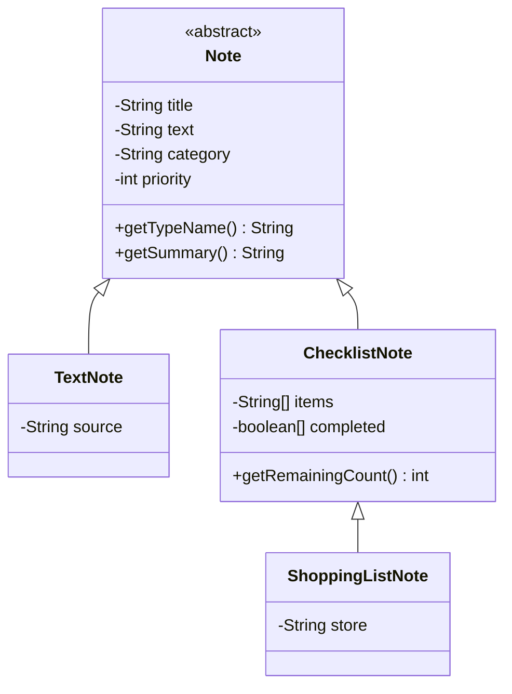

# Personal-notate

Консольний застосунок для ведення персональних нотаток на Java.

Лабораторна робота №6 — Реалізація ієрархії класів на основі принципів наслідування.

Ця версія продовжує ЛР №5. Програма підтримує текстові нотатки, списки справ і списки покупок. Через меню можна додавати записи, переглядати їх, шукати, сортувати та отримувати статистику протягом одного сеансу.

## Запуск

Потрібен установлений JDK 25. Додаткові бібліотеки не потрібні.

Відкрийте CMD або PowerShell у папці проєкту, де розташовані `run.cmd`, `build.cmd` та `src`, і виконайте:

```powershell
.\run.cmd
```

Скрипт налаштовує UTF-8, компілює програму та запускає її після успішної компіляції. Скомпільовані класи створюються в папці `out`.

## Створення нотаток

Оберіть пункт **1**, вкажіть кількість нотаток і для кожної виберіть тип:

| Тип | Призначення | Додаткові дані |
| --- | --- | --- |
| 1 — Текстова нотатка | Звичайний текстовий запис | Джерело запису, наприклад «Лекція»; можна залишити порожнім |
| 2 — Список справ | Перелік завдань | Пункти списку та позначки їх виконання |
| 3 — Список покупок | Перелік товарів | Пункти, позначки придбання та магазин; магазин можна не вказувати |

Для будь-якого типу введіть спільні поля:

- **Назва** — не може бути порожньою або складатися лише з пробілів.
- **Текст** — опис нотатки; можна залишити порожнім.
- **Категорія** — наприклад «Особисте», «Навчання» або «Робота»; можна залишити порожньою.
- **Пріоритет** — ціле число від 1 до 10, де 1 означає найвищий пріоритет.

Кожне поле підтверджується натисканням Enter. Текст вводиться одним рядком: Enter завершує його введення.

Для списків укажіть від 1 до 20 пунктів. Назва кожного пункту має бути непорожньою. Після кожного пункту введіть **1**, якщо його вже виконано або придбано, або **0**, якщо ще ні. У повному форматі ці стани позначаються `[x]` та `[ ]`.

Позначки задаються під час створення. Окремого редагування нотаток і перемикання позначок після створення в цій версії немає.

Після успішного додавання з’являється повідомлення `[Журнал]`, а статистика оновлюється. Некоректні дані супроводжуються поясненням помилки та запитом повторного введення.

## Головне меню

Введіть номер дії та натисніть Enter.

| Команда | Дія |
| --- | --- |
| 1 | Додати одну або кілька нотаток вибраних типів |
| 2 | Переглянути всі нотатки в поточному форматі |
| 3 | Знайти нотатки за пріоритетом і показати їх кількість |
| 4 | Відсортувати за пріоритетом: від 1 до 10; показати порядок до й після |
| 5 | Знайти нотатку за повним збігом типу та всіх полів |
| 6 | Показати список назв і відкрити нотатку за номером |
| 7 | Змінити формат відображення |
| 8 | Порівняти три формати однієї нотатки |
| 9 | Переглянути загальну кількість доданих нотаток і розподіл за пріоритетами |
| 10 | Запустити навчальну демонстрацію наслідування |
| 11 | Отримати інформацію, що залежить від типу вибраної нотатки |
| 0 | Завершити роботу |

Після виконання дії меню з’являється знову. У вікнах вибору нотатки або формату значення **0** повертає до меню, якщо це зазначено в запрошенні.

Номери нотаток відповідають поточним позиціям у списку. Після сортування вони можуть змінитися.

## Формати відображення

У пункті **7** доступні:

- **1 — Повний:** тип нотатки, спільні поля та всі додаткові дані — джерело, пункти списку, позначки або магазин.
- **2 — Стислий:** назва, категорія та пріоритет одним рядком.
- **3 — Застарілий:** чотири спільні поля з позначкою `[LEGACY]`; додаткові поля підкласів не показуються.

Щоб побачити весь вміст нотатки, оберіть повний формат. Зміна формату не змінює самі дані.

Пункт **8** показує вибрану нотатку в усіх трьох форматах і залишає поточний формат без змін.

## Пошук, статистика та підказки

Для пошуку в пункті **3** достатньо ввести потрібний пріоритет. Показуються всі збіги та їх кількість.

У пункті **5** потрібно повторити тип і всі дані шуканої нотатки. Враховуються регістр літер, пробіли, додаткові поля, порядок пунктів та їхні стани. Якщо є кілька однакових записів, показується перший знайдений. Введення зразка для пошуку не створює нової нотатки.

Пункт **9** враховує лише успішні додавання. Перегляд, пошук, сортування та навчальна демонстрація не збільшують статистику.

Пункт **11** показує джерело текстової нотатки, кількість невиконаних справ або магазин і кількість непридбаних позицій для списку покупок.

## Навчальна демонстрація

Пункт **10** призначений для показу механізмів ЛР №6. Він працює навіть без створених користувачем нотаток.

Програма створює окремі приклади та показує порядок виклику конструкторів, різну поведінку нотаток через спільний тип, визначення типу об’єкта, порівняння нотаток і перемикання форматера.

Демонстраційні об’єкти не додаються до користувацького списку. Після виконання програма повертається до меню.

## Приклад користування

1. Оберіть **1**, кількість **1**, тип **3 — Список покупок**.
2. Уведіть назву «Продукти», текст «На вечерю», категорію «Особисте» та пріоритет **2**.
3. Укажіть **2** пункти: «Хліб» зі станом **1** і «Молоко» зі станом **0**. Магазин — «Супермаркет».
4. Через пункт **6** відкрийте нотатку №1. У повному форматі хліб матиме позначку `[x]`, а молоко — `[ ]`.
5. Через пункт **11** виберіть цю нотатку. Залишиться одна непридбана позиція.
6. Перегляньте пункт **9**: якщо сеанс починався з порожнього списку, додано одну нотатку з пріоритетом 2.
7. Запустіть пункт **10** і повторіть перегляд статистики. Кількість користувацьких нотаток залишиться тією самою.
8. Введіть **0** у головному меню для завершення роботи.

## Зберігання

Застосунок зберігає до 100 нотаток усіх типів разом у пам’яті. Після заповнення списку додавання нових нотаток недоступне.

Запис у файл не виконується. Після завершення програми нотатки та статистика втрачаються. Наступний запуск починається з порожнього списку.

## Реалізація ЛР №6

### Ієрархія класів



Текстова нотатка і список справ є різновидами нотатки. Список покупок є різновидом списку: його пункти означають товари, а виконання — придбання. Усі типи підтримують спільні операції блокнота.

`Note` зберігає чотири спільні поля та їх перевірки. Додаткові поля розташовані у відповідних підкласах. Усі поля моделей — `private final`; масиви пунктів і станів копіюються в конструкторі.

`Note` є абстрактним, оскільки описує спільну основу. Конкретний вид запису представлений підкласом. Методи `getTypeName()` і `getSummary()` абстрактні: назва типу та підсумок залежать від конкретної нотатки, тому підкласи визначають їх самостійно.

### Конструктори та поліморфізм

Основні конструктори підкласів викликають `super(...)`, а скорочені — інший конструктор того самого класу через `this(...)`. Для списку покупок спочатку ініціалізується частина `Note`, потім `ChecklistNote`, потім `ShoppingListNote`. Це ініціалізація одного об’єкта.

Кожен підклас перевизначає методи з `@Override` і доповнює `super.toString()` своїми полями. У масиві `Note[]` один виклик `getSummary()` виконує реалізацію фактичного типу: текст показує джерело, список підраховує виконане, покупки — залишок і магазин.

`Note.getPriority()` оголошено `final`, щоб підкласи не змінювали спосіб отримання перевіреного пріоритету. `TextNote` і `ShoppingListNote` — завершені гілки ієрархії, тому їхні класи також `final`.

У демонстрації посилання оголошене як `Note`, але містить об’єкт `ShoppingListNote`. Оголошений тип визначає доступні методи, фактичний — реалізацію перевизначеного методу. Перевірка `instanceof ChecklistNote checklist` дозволяє безпечно викликати специфічний `getRemainingCount()`.

### Порівняння та композиція

У базовому класі та підкласах перевизначені `equals()` і `hashCode()`. Порівнюються спільні й додаткові поля; масиви порівнюються за вмістом.

Обрано перевірку `getClass()`: різні фактичні класи не рівні в обох напрямках. Тому порівняння списку справ зі списком покупок дає `false`, як і зворотне порівняння. Перевірка через `instanceof` допускає підкласи й потребує узгодженого правила рівності на всіх рівнях; інакше додаткові поля можуть порушити симетрію. Однакові за `equals()` нотатки мають однаковий `hashCode()`.

`NoteDisplay` містить `NoteFormatter` і може замінювати його під час роботи — це композиція. Відношення «NoteDisplay є форматером» не відповідає ролі класу. Наслідування від конкретного форматера прив’язало б клас до цього способу показу; змінити батьківський клас об’єкта під час роботи неможливо. `Notebook` також використовує композицію: містить нотатки, а не є однією з них.

### Sealed та switch

`Note` оголошений `sealed` і дозволяє підкласи `TextNote` та `ChecklistNote`. `ChecklistNote` також `sealed` і дозволяє `ShoppingListNote`.

`NoteTypeGuide` використовує `switch` із перевіркою типів. Випадок покупок розташований перед загальним випадком списку. Закрита ієрархія дозволяє компілятору перевірити повноту охоплення типів. Новий прямий підклас `Note`, не охоплений наявними випадками, вимагатиме доповнення `switch`.

Пояснення для підготовки до захисту містяться у [DEFENSE.md](DEFENSE.md).
